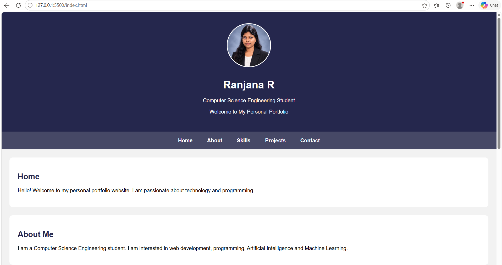
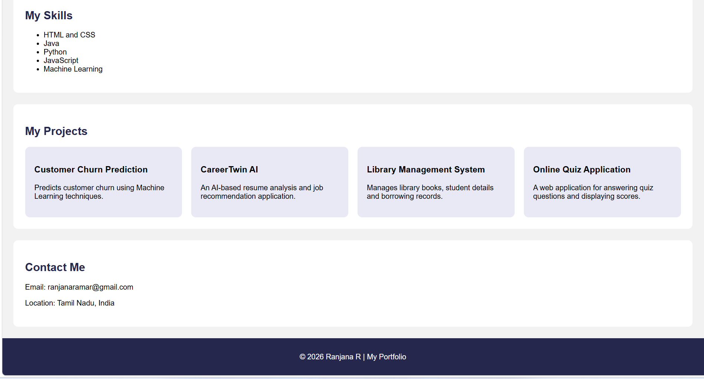

# Ex01 Portfolio
## Date:30-10-26

## AIM
To create a Portfolio using HTML and CSS.

## ALGORITHM
### STEP 1
Create an HTML file (index.html)

### STEP 2
Create a CSS file (style.css)

### STEP 3
Include a navigation bar with links to different sections.

### STEP 4
Add structured sections for introduction, about, projects, and contact details.

### STEP 5
Define global styles for fonts, colors, and layout.

### STEP 6
Style the header, navigation bar, and sections.

### STEP 7
Use Flexbox or CSS Grid for layout design.

### STEP 8
Add hover effects and transitions for interactivity.

### STEP 9
Add Images and Media.

### STEP 10
Use optimized images for a professional look.

### STEP 11
Open the HTML file in a browser to check layout and functionality.

### STEP 12
Fix styling issues and refine content placement.

### STEP 13
Deploy the Portfolio.

### STEP 14
Upload to GitHub Pages for free hosting.

## PROGRAM

<!DOCTYPE html>
<html>
<head>
    <title>My Portfolio</title>

    
</head>

<body>

    <header>
        <h1>Ranjana R</h1>
        
Computer Science Engineering Student

        
Welcome to My Personal Portfolio

    </header>

    <nav>
        <a href="#home">Home</a>
        <a href="#about">About</a>
        <a href="#skills">Skills</a>
        <a href="#projects">Projects</a>
        <a href="#contact">Contact</a>
    </nav>

    <section id="home">
        <h2>Home</h2>
        
Hello! Welcome to my personal portfolio website.
        I am passionate about technology and programming.

    </section>

    <section id="about">
        <h2>About Me</h2>
        
I am a Computer Science Engineering student.
        I am interested in web development, programming,
        Artificial Intelligence and Machine Learning.

    </section>

    <section id="skills">
        <h2>My Skills</h2>
        <ul>
            <li>HTML and CSS</li>
            <li>Java</li>
            <li>Python</li>
            <li>JavaScript</li>
            <li>Machine Learning</li>
        </ul>
    </section>

    <section id="projects">
        <h2>My Projects</h2>

        

            

                <h3>Customer Churn Prediction</h3>
                
Predicts customer churn using
                Machine Learning techniques.

            

            

                <h3>CareerTwin AI</h3>
                
An AI-based resume analysis and
                job recommendation application.

            

            

                <h3>Library Management System</h3>
                
Manages library books, student
                details and borrowing records.

            

            

                <h3>Online Quiz Application</h3>
                
A web application for answering
                quiz questions and displaying scores.

            

        

    </section>

    <section id="contact">
        <h2>Contact Me</h2>
        
Email: ranjanaramar@gmail.com

        
Location: Tamil Nadu, India

    </section>

    <footer>
        
© 2026 Ranjana R | My Portfolio

    </footer>

</body>
</html>

## OUTPUT

## RESULT
The program for creating Portfolio using HTML and CSS is executed successfully.